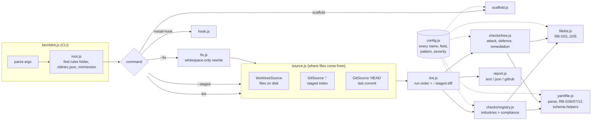
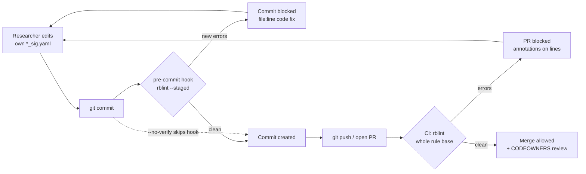
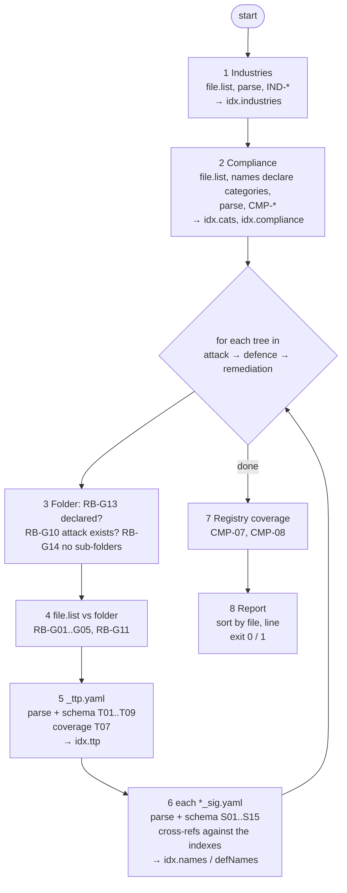
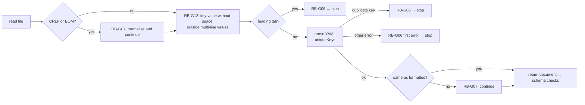

# rblint: the SATLAS rule base linter

`rblint` checks the SATLAS rule base before anything reaches the scan engine. It runs on every
commit (pre-commit hook) and on every pull request (required CI check). It blocks the change with a
message that names the file, line, rule code and the exact fix.

```
attack/agent/sb_sig.yaml
  ✖ 12:15   ATK-S12  severity "severe" is not allowed
                     fix: use one of: low, medium, high, critical
```

**Version 0.4.0** · Node 18+ · one bundled dependency (`yaml` 2.8.1) · licence: internal (UNLICENSED)

The rule base itself lives in a separate repository with its own README, which explains the
folders, the ownership model and the content. This document covers the linter only.

---

## Contents

1. [Purpose and responsibilities](#1-purpose-and-responsibilities)
2. [Install](#2-install)
3. [Use](#3-use)
4. [Set up a rule base repo](#4-set-up-a-rule-base-repo-once)
5. [High-level design](#5-high-level-design)
6. [Workflow of one run](#6-workflow-of-one-run)
7. [What is validated, file by file](#7-what-is-validated-file-by-file)
8. [Rule code reference](#8-rule-code-reference)
9. [Source layout](#9-source-layout)
10. [Maintenance guide](#10-maintenance-guide)
11. [Troubleshooting](#11-troubleshooting)

---

## 1. Purpose and responsibilities

The scan engine loads the rule base as data: attack prompts, detections, remediations and the
compliance mappings that tie them to OWASP, MITRE ATLAS, NIST AI RMF and the EU AI Act. A typo in
one YAML file can stop a category from loading, or silently link a detection to the wrong attack.
rblint finds these mistakes at commit time, while the author still remembers the change.

**rblint is responsible for:**

| area | what it guarantees |
|---|---|
| Inventory | Each folder's `file.list` matches the files in it. Only listed files are read. File names follow the naming rules. |
| YAML health | Every file parses, has no repeated keys or tabs, and matches the house formatting (2-space indent, a space after every `key:`). |
| Schema | Each file type has its root key, required fields, allowed fields only, and allowed values (for example severity). |
| Identity | Every ttp id is registered in compliance, belongs to its folder's category, and has the `<category>_NN` form. |
| Cross-file references | Each signature's `id` is a declared ttp. Each `agent` exists in the industries list. Each defence/remediation `target` is a real attack signature of the same ttp. |
| Uniqueness | Attack signature names are unique in a category. Ttp ids and names, detection names and compliance ids are unique where they need to be. |
| Coverage (warnings) | Every attack ttp has defence and remediation entries. Every registered id is used. Every declared category has an attack folder. |

**rblint does not:**

- judge whether a prompt is a good attack or a detection regex is effective. That is review work.
- check that compliance control ids (for example `AML.T0051`) exist in the external frameworks.
- talk to the scan engine, network or database. It reads files only.
- change a value. `--fix` only touches whitespace, and refuses any file whose data would change.

---

## 2. Install

rblint is a global command, like `eslint -g`. Nothing is copied into the rules repo.

```sh
# From the release tarball (works offline: the yaml dependency is bundled inside).
# In this source tree it is release/rblint-0.4.0.tgz; `npm pack` rebuilds it.
npm install -g ./release/rblint-0.4.0.tgz

rblint --version          # 0.4.0
```

Other ways to distribute the same package:

```sh
npm install -g git+https://github.com/<org>/rblint.git#v0.4.0      # private git repo, pinned to a tag
npm install -g @sandboxsecurity/rblint@0.4.0                        # private registry, after scoping the name
```

To upgrade, install the newer tarball the same way. To remove it, run `npm uninstall -g rblint`.

---

## 3. Use

Run it anywhere inside the rule base repo. It finds the rules folder itself (see *Finding the rules
folder* below).

| command | who | what it does |
|---|---|---|
| `rblint` | CI, anyone | Checks the whole rule base. |
| `rblint --staged` | pre-commit hook | Checks the **staged** version of every file and reports only problems this commit adds. Problems already on `HEAD` (someone else's) never block you; breakage you cause in another file does. |
| `rblint --fix` | researchers | Whitespace only: adds the space after `key:`, turns tabs into spaces, fixes indentation, converts CRLF to LF and removes a BOM. Text inside multi-line values is never touched. If the parsed data would differ in any way, the file is left alone. |
| `rblint scaffold` | seniors | Creates `attack/`, `defence/` and `remediation/<category>/` with `file.list` and a `_ttp.yaml` listing every registered id, for each category in compliance. Names are left empty so the linter fails until a maintainer fills them in. It never overwrites a file. |
| `rblint install-hook` | everyone, once per clone | Makes every commit run `rblint --staged`. It won't replace a pre-commit hook it didn't write unless you add `--force`. |
| `rblint uninstall-hook` | | Removes that hook. |
| `rblint where` | | Prints the rules folder it would check, and why. |

Options: `--format text|json|github` · `--dry-run` (with `--fix` or `scaffold`) · `--force`
(with `install-hook`) · `--no-color` · `-h` · `-v`. Any command also takes a folder: `rblint path/to/rules`.

**Exit codes:** `0` clean, or warnings/info only · `1` errors found · `2` rblint could not run (no
rule base found, bad option, rblint older than the repo's `minVersion`).

**Severities:**

- `✖ error` blocks the commit or PR.
- `⚠ warning` asks for a second look and does not block.
- `i info` explains why a check was skipped (for example, a file it depends on failed to parse).

**Finding the rules folder** (first match wins):

1. the folder given on the command line (if it is a repo top holding `.rblintrc.json`, that file's `root` is followed);
2. `root` in the nearest `.rblintrc.json`;
3. the current folder, or `./rules`;
4. the git repo top, or `top/rules`;
5. the first folder up to 3 levels below the top that holds `_compliance_industries_agents/`.

---

## 4. Set up a rule base repo (once)

1. **Pin the version.** Commit a `.rblintrc.json` at the repo top:

   ```json
   { "root": "new-rules", "minVersion": "0.4.0" }
   ```

   rblint is installed separately on each laptop, so an old install could pass something CI
   rejects. With `minVersion` set, an outdated rblint stops with "this repo needs rblint 0.4.0
   or newer". Raise it whenever a release adds checks.

2. **Hook.** Every researcher runs `rblint install-hook` once after cloning.

3. **CI.** Copy `ci/rblint.yml` from this package into the rules repo as
   `.github/workflows/rblint.yml`. Set `RBLINT_TGZ_URL` (and a `RBLINT_TOKEN` secret if the
   tarball is private), then in branch protection for `main` turn on **Require status checks to
   pass**, select `rblint`, and turn on **Do not allow bypassing**.

   The hook gives early feedback, but `git commit --no-verify` skips it, and git has no way to
   disable that flag. The required CI check is the step nobody can skip.

---

## 5. High-level design

### 5.1 Components



**Design principles:**

- **One source abstraction.** Checks never touch the filesystem directly; they ask a *source*
  (`list`, `read`, `isDir`). The same checks therefore run on the working tree (CI, manual), the
  git index (`--staged`), or `HEAD` (the baseline `--staged` compares against).
- **Configuration in one file.** Every folder name, root key, required/allowed field, file-name
  pattern and severity lives in `src/config.js`. Most schema changes are a one-file edit.
- **Indexes, built in order.** Each step only reads indexes that earlier steps built. That is
  why the registry runs first, then `attack/`, then `defence/` and `remediation/`.
- **Fail soft, never cascade.** If a file can't be parsed, the checks that depend on it are
  skipped with an `i` line. One broken file never produces a page of follow-on errors.
- **Every message is actionable.** Each problem names the location, a stable code, what is
  wrong (with the clashing value or place), and one concrete fix.

### 5.2 The shared index

Built during one run and read by later checks:

| index (`ctx.idx`) | built by | holds | read by |
|---|---|---|---|
| `industries` | registry: `industries_agent.yaml` | `Banking`, `Banking.Loan`, ... | ATK-S14 |
| `cats`, `catFiles` | registry: compliance file names | declared categories | RB-G13, category checks, CMP-07 |
| `compliance` | registry: compliance files | registered id → `file:line` | `*-T09`, `*-S09`, ATK-T08, CMP-08 |
| `ttp[cat]` | `attack/<cat>/_ttp.yaml` | attack ttp ids | ATK-S10, DEF/REM-T06, DEF/REM-T07, CMP-08 |
| `names[cat]` | `attack/<cat>/*_sig.yaml` | signature name → `{at, id}` | ATK-S11, DEF/REM-S11, DEF-S13, REM-S15 |
| `namesComplete[cat]` | attack tree | false if any attack file is unusable | disables S11/S13/S15 for that category |
| `defNames[cat]` | `defence/<cat>/*_sig.yaml` | detection names | DEF-S14 |

If an index is incomplete (for example a compliance file doesn't parse), it is set to `null`, and
every check that needs it is skipped with an `RB-I01` info line instead of guessing.

---

## 6. Workflow of one run

### 6.1 Where rblint runs



### 6.2 Inside one run



Every YAML file goes through the same loader (`yamlfile.load`) before its own schema checks:



### 6.3 `--staged`

1. Lint the git index (`GitSource(":")`). This is exactly what the commit will contain.
2. Lint `HEAD` the same way.
3. Report only problems in (1) that are not in (2). Problems are matched on file + code + message,
   with line numbers and entry positions (`line 12`, `file.yaml:12`, `signature 5`) removed. So
   adding lines above an old problem doesn't make it look new.
4. On the very first commit (no `HEAD`), everything in (1) is reported.

### 6.4 `--fix`

For every `.yaml` file under the registry and the three trees:

1. Normalise CRLF to LF and remove a BOM.
2. Outside multi-line values only: turn leading tabs into spaces, and add the space after `key:`.
3. Parse. If it still fails, leave the file alone and report it as skipped.
4. Re-serialise with the house format (`FORMAT` in `config.js`).
5. Safety gate: if the original parsed, its data must equal the result's data exactly, or the
   file is left alone. Then the normal lint runs and shows what is left.

---

## 7. What is validated, file by file

`P` below is the code prefix of the tree: `ATK`, `DEF` or `REM`.

### 7.1 Every folder that holds rule files

Applies to `_compliance_industries_agents/`, `_compliance_industries_agents/compliance/` and every
`<tree>/<category>/`:

| step | check |
|---|---|
| `file.list` exists | RB-G01 |
| every listed name exists | RB-G02 |
| every file is listed (dotfiles ignored) | RB-G03 |
| no duplicate lines, no paths (`/`) | RB-G04 |
| file name allowed for this folder; a bad name is reported and **not parsed** | RB-G05 |
| blank lines and `# comments` in `file.list` | allowed |

### 7.2 Every listed `.yaml` file

| check | code |
|---|---|
| a space after every `key:` (outside multi-line text values) | RB-G12 |
| no tab indentation, no repeated key, valid YAML | RB-G06 |
| formatting equals the house format; LF line endings; no BOM | RB-G07 |
| exactly one top-level key, holding a list | RB-G09 (plus RB-G08 for any other top-level key) |
| no field outside the file type's allowed list | RB-G08 |
| a value starting with `#` (read by YAML as a comment) is reported with a hint to quote it | the field's own "required" code |

### 7.3 `_compliance_industries_agents/industries_agent.yaml`

Root `agents:` · fields `name`, `description`, `sub`

| check | code |
|---|---|
| it is the only file in the folder (besides `file.list` and `compliance/`) | IND-01 |
| root key `agents:` holds a list | IND-02 |
| `name` on every entry and every `sub` entry | IND-03 |
| `name` unique among siblings (`Banking.Loan` and `Healthcare.Loan` can both exist) | IND-04 |
| no `.` in a name (`.` joins parent and sub) | IND-05 |
| `description` is text; `sub` is a list of the same shape | IND-06 |

Output: `idx.industries`, the full names (`Generic`, `Banking`, `Banking.Loan`, ...).

### 7.4 `_compliance_industries_agents/compliance/_<category>_mapping.yaml`

Root `compliance:` · fields `id`, `map`

| check | code |
|---|---|
| folder exists; the file name declares the category (`_mcp_top_10_mapping.yaml` → `mcp_top_10`) | CMP-05, RB-G05 |
| `id` present | CMP-01 |
| `id` registered once across the whole folder | CMP-02 |
| `map` present with at least one framework | CMP-03 |
| each framework lists at least one control | CMP-04 |
| `id` is `<category>_NN` (two or more digits) for this file's category | CMP-06 |
| (warn) a declared category has no `attack/<category>/` | CMP-07 |
| (warn) a registered id is not declared in `attack/<category>/_ttp.yaml` | CMP-08 |

Output: `idx.cats` (from file names, so known even if a file fails), and `idx.compliance` (all or
nothing: one unparseable file sets it to `null` and skips every "registered" check).

### 7.5 `<tree>/<category>/_ttp.yaml`

Root `ttps:` · attack fields `id name description references applicable_to compliance` · defence
and remediation fields `id name description references`

| check | code | trees |
|---|---|---|
| `id` present | P-T01 | all |
| `id` declared once in the file | P-T02 | all |
| `name` present | P-T03 | all |
| `name` unique in the category (case-insensitive) | ATK-T04 | attack |
| `id` is `<category>_NN` of **this** folder (longest category match: `mcp_top_10_01` is never an `mcp` id) | P-T05 | all |
| (warn) id is registered but the attack `_ttp.yaml` doesn't declare it | P-T06 | defence, remediation |
| (warn) an attack ttp has no entry here | P-T07 | defence, remediation |
| `compliance` present | ATK-T07 | attack |
| `compliance` is a registered id | ATK-T08 | attack |
| `id` registered in compliance | P-T09 | all |

### 7.6 `attack/<category>/<author>_sig.yaml`

Root `signatures:` · fields `id name severity agent prompt attack tier`

| check | code |
|---|---|
| root `signatures:` list | ATK-S01 |
| required: `id`, `name`, `severity`, `prompt`, `attack` | ATK-S02 … S06 |
| `id` is this category's | ATK-S08 |
| `id` registered in compliance | ATK-S09 |
| `id` declared in `attack/<category>/_ttp.yaml` (it repeats freely: one ttp, many prompts) | ATK-S10 |
| `name` unique across **every** author's file in the category, compared as the full string | ATK-S11 |
| `severity` is `low`, `medium`, `high` or `critical` | ATK-S12 |
| `agent` key present and a list (`[]` is fine) | ATK-S13 |
| every `agent` value is a name or `Parent.Sub` from `industries_agent.yaml` | ATK-S14 |

### 7.7 `defence/<category>/<author>_sig.yaml`

Root `signatures:` · fields `id name target refusal_regex`

| check | code |
|---|---|
| root `signatures:` list | DEF-S01 |
| required: `id`, `target`, `refusal_regex` | DEF-S02 … S04 |
| `id` is this category's / registered / declared in `defence/<category>/_ttp.yaml` | DEF-S08 / S09 / S10 |
| `target` equals an attack signature name in `attack/<category>/` | DEF-S11 |
| (warn) `refusal_regex` compiles. Python spellings are accepted: leading `(?i)`, `(?P<name>…)`, `(?P=name)`; verbose `(?x)` patterns are not checked. | DEF-S12 |
| `id` equals the ttp of the attack it targets | DEF-S13 |
| `name`, when given, is unique across the category's defence files | DEF-S14 |

### 7.8 `remediation/<category>/<author>_sig.yaml`

Root `remediations:` · fields `id name target title mitigation_steps description signature_id`

| check | code |
|---|---|
| root `remediations:` list | REM-S01 |
| required: `id`, `target`, `title`, `mitigation_steps` | REM-S02 … S05 |
| `id` is this category's / registered / declared in `remediation/<category>/_ttp.yaml` | REM-S08 / S09 / S10 |
| `target` equals an attack signature name in `attack/<category>/` | REM-S11 |
| `target` unique within this author's file | REM-S12 |
| `title` unique within this author's file (case-insensitive) | REM-S13 |
| `mitigation_steps` is a non-empty list | REM-S14 |
| `id` equals the ttp of the attack it targets | REM-S15 |

`name`, `description` and `signature_id` are allowed and optional; their values are not checked.

### 7.9 Folder structure

| check | code |
|---|---|
| no files directly in `attack/`, `defence/`, `remediation/`; no sub-folders inside a category | RB-G14 |
| every category folder is declared in compliance | RB-G13 |
| `defence/<cat>` and `remediation/<cat>` need `attack/<cat>` | RB-G10 |
| every category's `file.list` includes `_ttp.yaml` | RB-G11 |

---

## 8. Rule code reference

Codes are stable: they appear in docs, CI annotations and team conversations, so **never reuse or
renumber a code**. Retire it instead.

| code | severity | rule |
|---|---|---|
| RB-G01 | error | folder has a `file.list` |
| RB-G02 | error | every name in `file.list` exists |
| RB-G03 | error | every file in the folder is listed |
| RB-G04 | error | no duplicate or path entries in `file.list` |
| RB-G05 | error | file name allowed here |
| RB-G06 | error | parses: no syntax error, repeated key or tab indent |
| RB-G07 | error | house formatting, LF line endings, no BOM (`--fix`) |
| RB-G08 | error | no unknown field or extra top-level key |
| RB-G09 | error | one root key holding a list; entries are `field: value` maps |
| RB-G10 | error | defence/remediation category needs an attack category |
| RB-G11 | error | category `file.list` includes `_ttp.yaml` |
| RB-G12 | error | space after `key:` (`--fix`) |
| RB-G13 | error | category declared in compliance |
| RB-G14 | error | no stray files in tree roots; no sub-folders in categories |
| RB-I01 | info | a check was skipped because a file it needs failed first |
| IND-01 … 06 | error | industries file (see 7.3) |
| CMP-01 … 06 | error | compliance files (see 7.4) |
| CMP-07, CMP-08 | warn | registry coverage |
| ATK-T01 … T05, T07 … T09 | error | attack `_ttp.yaml` (see 7.5) |
| DEF-T / REM-T 01, 02, 03, 05, 09 | error | defence / remediation `_ttp.yaml` |
| DEF-T / REM-T 06, 07 | warn | defence / remediation ttp coverage |
| ATK-S01 … S06, S08 … S14 | error | attack signatures (see 7.6) |
| DEF-S01 … S04, S08 … S11, S13, S14 | error | defence signatures (see 7.7) |
| DEF-S12 | warn | regex compiles |
| REM-S01 … S05, S08 … S15 | error | remediation signatures (see 7.8) |

---

## 9. Source layout

```
rblint/
├── bin/rblint.js          CLI: arguments, commands, output format, exit codes
├── src/
│   ├── config.js          every name, field list, pattern, severity and the house FORMAT
│   ├── root.js            finds the rules folder; reads .rblintrc.json; minVersion check
│   ├── source.js          WorktreeSource (disk) and GitSource (index ":" or "HEAD")
│   ├── lint.js            run order; --staged comparison (newProblems, stable)
│   ├── filelist.js        file.list against the folder: RB-G01..G05
│   ├── yamlfile.js        loader (RB-G06/07/12), multi-line value detection, fixText,
│   │                      schema helpers: rootList, checkFields, requireValue
│   ├── checks/
│   │   ├── registry.js    industries_agent.yaml (IND-*) and compliance (CMP-01..06)
│   │   └── tree.js        attack/defence/remediation: _ttp.yaml (*-T), *_sig.yaml (*-S),
│   │                      folder rules, coverage (CMP-07/08), regex check
│   ├── report.js          Reporter; text, json and GitHub-annotation output
│   ├── fix.js             rblint --fix
│   ├── scaffold.js        rblint scaffold
│   └── hook.js            install-hook / uninstall-hook
├── test/
│   ├── fixtures/valid/    a small real rule base (agent + owasp_top_10) that must lint clean
│   ├── helpers.js         copy the fixture, edit it, run the linter
│   ├── checks.test.js     one planted mistake per rule code
│   ├── regressions.test.js  bugs found in review, so they stay fixed
│   └── cli.test.js        exit codes, formats, --staged, hook, scaffold, root detection
├── ci/rblint.yml          GitHub Actions workflow for the rules repo
├── CHANGELOG.md
└── package.json
```

---

## 10. Maintenance guide

### 10.1 Develop

```sh
npm ci                 # once (or use the bundled node_modules)
npm test               # 92 tests, about 10 s
node bin/rblint.js /path/to/rules        # run your working copy
npm link               # optional: make your working copy the global "rblint"
```

### 10.2 Common changes

| change | where |
|---|---|
| add an allowed or required field | `config.js` → `TTP` or `SIG`. Required order fixes the codes (first required = S02); append new required fields at the end so existing codes don't shift. |
| new root key for a file type | `config.js` → `SIG[tree].root` / `COMPLIANCE_ROOT` |
| allowed severities | `config.js` → `SEVERITIES` |
| file-name rules | `config.js` → `SIG_RE`, `MAP_RE`; id form → `idRe` |
| house formatting | `config.js` → `FORMAT`; then run `rblint --fix` once on the rules repo |
| new cross-file check | `checks/tree.js` (or `registry.js`). Read from `ctx.idx` only what was built earlier; if it can be `null`, skip. |
| new tree (a fourth top-level folder) | `config.js` → `TREES`, `TTP`, `SIG`; mind the order (attack first) |

### 10.3 Adding a check, step by step

1. Pick the next free code in its family (for example `REM-S16`). Never reuse a retired code.
2. Implement it with `ctx.rep.add(file, line, col, code, message, fix, sev)`:
   - **message**: what is wrong, naming the value and the place it clashes with.
   - **fix**: one concrete next step.
   - **sev**: `"error"` (default) blocks; use `"warn"` for "probably wrong".
3. Add a row to `CASES` in `test/checks.test.js` that plants the mistake in the fixture.
4. Run the new rblint on the real rules repo. If it reports existing content, decide with the
   rule owners: fix the content in the same release, or ship the check as `warn` first.
5. Document it in sections 7 and 8 of this README and in `CHANGELOG.md`.
6. Release (below) and raise `minVersion` in the rules repo.

### 10.4 Release

```sh
# 1. bump "version" in package.json and add a CHANGELOG entry
npm test
npm pack                        # writes rblint-<version>.tgz with yaml bundled
# 2. smoke test the tarball itself
npm install -g ./rblint-<version>.tgz && rblint /path/to/rules
# 3. publish the tarball (release asset / internal server), update RBLINT_VERSION in the
#    rules repo's workflow, and raise minVersion in its .rblintrc.json in the same PR
```

---

## 11. Troubleshooting

| symptom | cause and fix |
|---|---|
| `this repo needs rblint X or newer` | Install the newer tarball. |
| `no rule base found` | Run inside the rules repo, pass the folder, or set `root` in `.rblintrc.json`. |
| Commit blocked by a problem you didn't cause | `--staged` only reports new problems. If one shows, your change triggered it (for example you renamed an attack signature that a defence entry targets). |
| `RB-G07` on a file you didn't reformat | The editor saved CRLF or tabs. Run `rblint --fix`, and set `git config core.autocrlf input`. |
| `RB-I01` lines | Not a failure. A check was skipped because a file it needs failed; fix the errors above it. |
| `--fix` says "skipped" | The file doesn't parse even after whitespace fixes. Fix the reported RB-G06 by hand. |
| Hook says rblint is not installed | `npm install -g ./rblint-<version>.tgz`, then commit again. |
| Need to commit anyway | `git commit --no-verify` skips the hook, but CI will still block the PR. |
